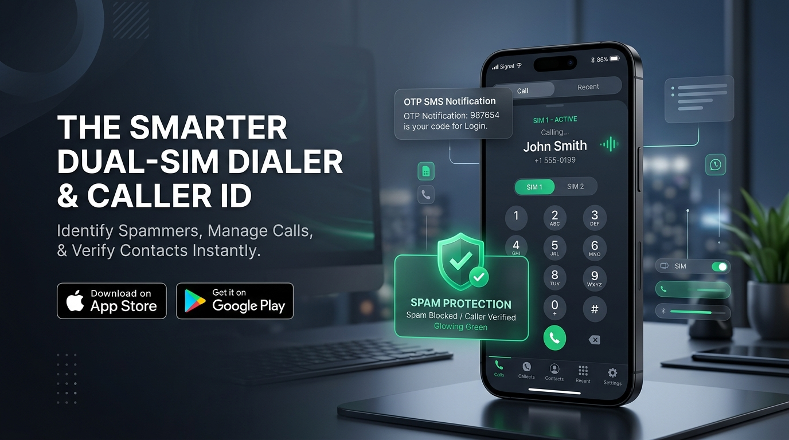
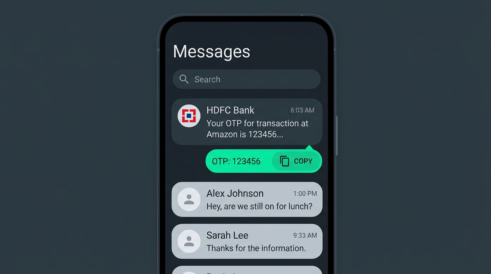

# 📱 Smart Dialer & Caller ID (স্মার্ট ডায়ালার, কলার আইডি ও এসএমএস আর্কিটেকচার)

[](https://web.dev/progressive-web-apps/)
[](https://react.dev/)
[](https://www.typescriptlang.org/)
[](https://tailwindcss.com/)
[-orange.svg)](https://dexie.org/)
[](https://firebase.google.com/)

---

<div align="center">
  
  <p><em>আধুনিক মেটেরিয়াল ডার্ক থিম, ডুয়াল সিম টেলিকম সুইচিং ও অ্যান্ড্রয়েড টেলিকম আর্কিটেকচার</em></p>
</div>

---

একটি পূর্ণাঙ্গ **স্মার্ট ডায়ালার, সিম কন্টাক্ট ম্যানেজার, গুগল মেসেজ ও ওটিপি এক্সট্রাক্টর, কলার আইডি ও অ্যান্ড্রয়েড টেলিকম আর্কিটেকচার সিমুলেশন অ্যাপ**। এই প্রজেক্টটি ওয়েব ও প্রগ্রেসিভ ওয়েব অ্যাপ (PWA) হিসেবে চলে এবং একই সাথে নেটিভ অ্যান্ড্রয়েড ওএস-এর টেলিকমিউনিকেশন আর্কিটেকচার (`InCallService`, `RoleManager`, `CallScreeningService`, `SmsReceiver`) সম্পূর্ণভাবে প্রদর্শন ও ব্যবহার উপযোগী করে তৈরি।

---

## 📸 অ্যাপ প্রিভিউ ও স্ক্রিনশট (Screenshots & UI Previews)

<table align="center" width="100%">
  <tr>
    <td width="50%" align="center">
      <h3>🛡️ স্মার্ট কলার আইডি ও স্প্যাম প্রোটেকশন</h3>
      
      <p><em>রিয়েল-টাইম স্প্যাম রিস্ক স্কোর, ফ্ল্যাশ কলার ওভারলে ও ভেরিফাইড ব্যাজ</em></p>
    </td>
    <td width="50%" align="center">
      <h3>💬 এসএমএস মেসেজ ও ১-ক্লিক ওটিপি</h3>
      
      <p><em>ব্যাংক ও সার্ভিস ওটিপি অটো ডিটেকশন ও ১-ক্লিক ক্লিপবোর্ড কপি</em></p>
    </td>
  </tr>
</table>

---

## 🌟 মূল বৈশিষ্ট্যসমূহ (Key Features)

### ১. 📞 ডুয়াল সিম স্মার্ট ডায়ালার (Dual-SIM Smart Dialer)
- **সিম ১ ও সিম ২ নির্বাচন:** প্রতিটি কলের পূর্বে সিম ১ বা সিম ২ নির্বাচন করে সেলুলার নেটওয়ার্কে সরাসরি ডায়াল করার সুবিধা (`tel:` ইন্টেন্ট সাপোর্ট)।
- **টি৯ (T9) স্মার্ট সার্চ:** ডায়ালপ্যাডের যেকোনো নম্বর টাইপ করে তাৎক্ষণিক নাম বা নম্বর ফিল্টারিং।
- **স্পিড ডায়াল ও লাইভ টোন:** কীপ্যাড স্পর্শে ভাইব্রেশন ও অডিও ফিডব্যাক।

### ২. 🛡️ স্মার্ট কলার আইডি ও স্প্যাম প্রোটেকশন (Caller ID & Spam Guard)
- **অফলাইন স্প্যাম ডাটাবেজ:** ইন্টারনেট ছাড়াই লোকাল ক্যাশ ও অফলাইন রুম ডিবি থেকে স্প্যাম ঝুঁকি স্কোর (Spam Risk Score) নির্ণয়।
- **ফ্লোটিং কলার আইডি ওভারলে (`SYSTEM_ALERT_WINDOW`):** ইনকামিং কলের সময় স্ক্রিনের ওপর ফ্লোটিং কলার তথ্য প্রদর্শনের সিমুলেশন।
- **স্প্যাম নম্বর রিপোর্ট ও ব্লক:** সন্দেহজনক নম্বর সরাসরি ব্লক বা কমিউনিটি রিপোর্টে যোগ করার ব্যবস্থা।

### ৩. 💬 গুগল মেসেজ ও ওটিপি হ্যান্ডলার (Messages & Smart OTP)
- **রিয়েল-টাইম এসএমএস ইনবক্স:** থ্রেড আকারে ইনকামিং ও আউটগোয়িং মেসেজ হিস্ট্রি।
- **১-ক্লিক ওটিপি ডিটেকশন:** ব্যাংক বা সার্ভিস থেকে আসা এসএমএস থেকে ৪-৮ সংখ্যার ভেরিফিকেশন কোড স্বয়ংক্রিয়ভাবে আলাদা করে ক্লিপবোর্ডে কপি করার সুবিধা।
- **স্প্যাম মেসেজ ফিল্টারিং:** অফার ও প্রতারণামূলক এসএমএস স্বয়ংক্রিয় শনাক্তকরণ।

### ৪. 📇 সিম ও লোকাল কন্টাক্ট ম্যানেজার (SIM & Local Contacts)
- **সিম ১, সিম ২ ও মেমোরি ফিল্টার:** সিম ভিত্তিক কন্টাক্ট সেভ, এডিট ও ডিলিট।
- **vCard (.vcf) এক্সপোর্ট ও ইমপোর্ট:** এক ক্লিকে সম্পূর্ণ ব্যাকআপ ডাউনলোড ও রিস্টোর।
- **ফেভারিট কন্টাক্ট ও জরুরি ডায়াল:** গুরুত্বপূর্ণ কন্টাক্ট দ্রুত অ্যাক্সেস।

### ৫. 💾 ১০০% অফলাইন ক্যাশ (Android Room Database Pattern via Dexie.js)
- অ্যান্ড্রয়েডের **Room Database & SQLite** আর্কিটেকচার অনুকরণে ক্লায়েন্ট-সাইড `IndexedDB` (Dexie.js) ইঞ্জিন।
- কোনো ইন্টারনেট না থাকলেও কল লগ, এসএমএস, কন্টাক্ট এবং স্প্যাম ডাটাবেজ সম্পূর্ণ স্থানীয়ভাবে সুরক্ষিত থাকে।

### ৬. ☁️ গুগল ফায়ারবেস ক্লাউড ব্যাকআপ (Firebase Sync - Optional)
- গুগল ফায়ারস্টোর (Firestore Database) ইন্টিগ্রেশন।
- মাল্টি-ডিভাইসে ডাটা ব্যাকআপ ও রিয়েল-টাইম সিঙ্ক।

---

## 🏗️ অ্যান্ড্রয়েড টেলিকম ও পারমিশন আর্কিটেকচার

অ্যাপটিতে গুগল অ্যান্ড্রয়েডের শীর্ষ টেলিকম ফ্রেমওয়ার্কের সম্পূর্ণ কোড ও লাইভ সিমুলেটর অন্তর্ভুক্ত রয়েছে:

| গুগল সার্ভিস / এপিআই | অ্যান্ড্রয়েড পারমিশন | কাজের বিবরণ |
| :--- | :--- | :--- |
| **`InCallService`** | `android.permission.BIND_INCALL_SERVICE` | সিস্টেমের ডিফল্ট ডায়ালার ও ইন-কল স্ক্রিন হ্যান্ডলার |
| **`RoleManager.ROLE_DIALER`** | `android.app.role.RoleManager` | ডিফল্ট ফোন অ্যাপ হিসেবে সিস্টেমে অধিগ্রহণ |
| **`RoleManager.ROLE_SMS`** | `android.permission.RECEIVE_SMS` | ডিফল্ট এসএমএস অ্যাপ ও ব্যাকগ্রাউন্ড ওটিপি ডিটেকশন |
| **`CallScreeningService`** | `android.permission.BIND_SCREEN_CALL_SERVICE` | ব্যাকগ্রাউন্ডে স্প্যাম কল স্বয়ংক্রিয় রিজেক্ট |
| **`Floating Overlay`** | `android.permission.SYSTEM_ALERT_WINDOW` | অন্য অ্যাপের ওপর কলার আইডি ভাসিয়ে তোলা |
| **`Native Call Log`** | `android.permission.READ_CALL_LOG`, `WRITE_CALL_LOG` | ফোনের নিজস্ব কল লগ হিস্ট্রি রিড/রাইট |

---

## 🚀 অ্যান্ড্রয়েড স্টুডিও ছাড়া সরাসরি ফোনে ব্যবহারের উপায় (Bypass Methods)

### পদ্ধতি ১: PWABuilder (সবচেয়ে সহজ - কোনো কোডিং ছাড়া)
১. অ্যাপটির ডিপ্লয়েড লাইভ URL সংগ্রহ করুন।
২. [PWABuilder.com](https://www.pwabuilder.com/) ওয়েবসাইটে গিয়ে URL-টি পেস্ট করুন।
৩. এটি অ্যাপের বিদ্যমান `manifest.json`, Service Worker ও মেটাডাটা স্ক্যান করবে।
৪. **"Generate Android APK / AAB"** বাটনে ক্লিক করে সরাসরি ইন্সটলযোগ্য `.apk` প্যাকেজ ডাউনলোড করে ফোনে চালান।

### পদ্ধতি ২: সরাসরি ফোনে PWA ইন্সটল (Chrome / Edge)
১. ফোনের গুগল ক্রোম ব্রাউজারে অ্যাপটির লিঙ্কটি ওপেন করুন।
২. অ্যাপের টপ বারে থাকা **"ফোনে ইনস্টল করুন" (Install App)** বাটনে চাপ দিন (অথবা ব্রাউজারের থ্রি-ডট মেনু থেকে **"Install app" / "Add to Home screen"** চাপুন)।
৩. হোমস্ক্রিনে অ্যাপ আইকন তৈরি হবে এবং ফুলস্ক্রিন নেটিভ অ্যাপের মতো অফলাইনে কাজ করবে।

### পদ্ধতি ৩: GitHub Actions ক্লাউড অটোমেশন (Cloud APK Build)
- কোনো অ্যান্ড্রয়েড স্টুডিও ছাড়াই GitHub এর ক্লাউড রানারে গ্র্যাডল কমান্ড দিয়ে অটোরিলিজ APK বিল্ড করে নেওয়া যায়।

---

## 📂 প্রোজেক্ট ফোল্ডার স্ট্রাকচার

```text
├── public/
│   ├── manifest.json              # PWA Web App Manifest (শর্টকাট, আইকন ও ক্যাটাগরি)
│   ├── pwa-192x192.png            # মোবাইল হোমস্ক্রিন আইকন
│   ├── pwa-512x512.png            # হাই-রেজুলেশন স্প্ল্যাশ আইকন
│   └── icon.svg                   # ভেক্টর আইকন
├── src/
│   ├── assets/images/             # UI স্ক্রিনশট ও অ্যাপ ইলাস্ট্রেশন
│   ├── components/
│   │   ├── Keypad.tsx             # ডুয়াল সিম ডায়ালপ্যাড ও T9 সার্চ
│   │   ├── CallLogs.tsx           # ইনকামিং, আউটগোয়িং ও মিসড কল হিস্ট্রি
│   │   ├── ContactsView.tsx       # সিম ১/২ ও লোকাল কন্টাক্ট তালিকা
│   │   ├── MessagesView.tsx       # এসএমএস ইনবক্স ও ওটিপি চিপস
│   │   ├── CallerIdLookup.tsx     # স্প্যাম স্কোর ও নম্বর লুকআপ
│   │   ├── ActiveCallModal.tsx    # চলমান কল ও কল-রেকর্ডিং সিমুলেশন
│   │   ├── FloatingCallerIdOverlay.tsx # ফ্লোটিং উইন্ডো কলার আইডি
│   │   ├── AndroidGuide.tsx       # নেটিভ কোড ও পারমিশন গাইড
│   │   └── PWAInstallButton.tsx   # ১-ক্লিক PWA ইন্সটলার
│   ├── services/
│   │   ├── roomDbService.ts       # Dexie.js অফলাইন ডেটাবেজ সার্ভিস
│   │   ├── firebase.ts            # ফায়ারস্টোর ক্লাউড কানেক্টিভিটি
│   │   └── spamDetection.ts       # স্মার্ট স্প্যাম অ্যানালাইসিস অ্যালগরিদম
│   ├── types.ts                   # টাইপস্ক্রিপ্ট ইন্টারফেস
│   ├── App.tsx                    # মূল অ্যাপ্লিকেশন রুট
│   └── main.tsx                   # রিঅ্যাক্ট ডম এন্ট্রি পয়েন্ট
├── firestore.rules                # ফায়ারবেস ক্লাউড সিকিউরিটি রুলস
├── vite.config.ts                 # Vite + PWA প্লাগইন কনফিগারেশন
├── package.json                   # প্রজেক্ট ডিপেন্ডেন্সিস
└── README.md                      # ডকুমেন্টেশন
```

---

## 💻 লোকাল ডেভেলপমেন্ট ও বিল্ড গাইড

### পূর্বশর্ত
- [Node.js](https://nodejs.org/) (সংস্করণ ১৮ বা তার পরবর্তী)
- npm বা bun প্যাকেজ ম্যানেজার

### ইন্সটলেশন
```bash
# ডিপেন্ডেন্সি ইন্সটল করুন
npm install

# ডেভেলপমেন্ট সার্ভার চালু করুন (Port 3000)
npm run dev

# প্রোডাকশন বিল্ড তৈরি করুন
npm run build

# টাইপস্ক্রিপ্ট এরর ও লিন্ট চেক করুন
npm run lint
```

---

## 🔒 নিরাপত্তা ও প্রাইভেসী (Security & Privacy)
- **১০০% লোকাল-ফার্স্ট:** আপনার কন্টাক্ট এবং কল লগ ডিভাইসের বাইরে কোনো সার্ভারে জোরপূর্বক পাঠানো হয় না।
- **নিরাপদ ওটিপি কপি:** ওটিপি কোডগুলো শুধুমাত্র ডিভাইসের মেমোরিতে প্রসেস হয়।
- **ফায়ারবেস রুলস:** ফায়ারবেসে ক্লাউড ব্যাকআপ নেওয়ার ক্ষেত্রে ব্যবহারকারীর নিজস্ব ইউজার আইডি (`auth.uid`) ছাড়া অন্য কেউ ডেটা অ্যাক্সেস করতে পারে না।

---

## 📄 লাইসেন্স
এই প্রজেক্টটি শিক্ষামূলক এবং প্রোডাকশন রেফারেন্স আর্কিটেকচার হিসেবে উন্মুক্ত।
MIT License এর আওতাভুক্ত।
